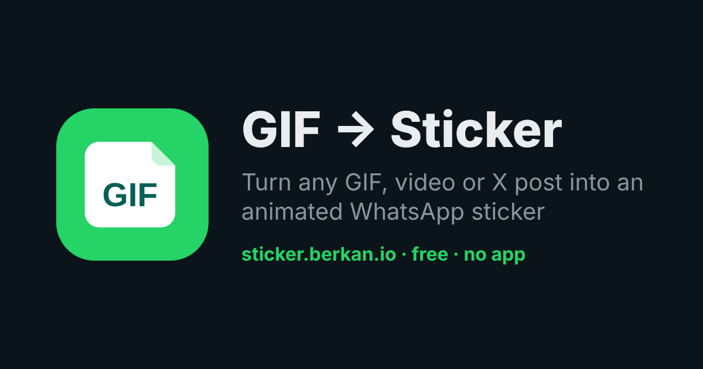
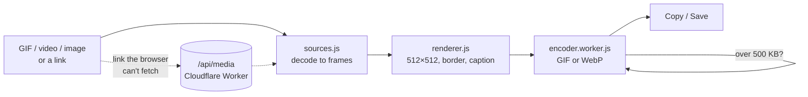

<div align="center">

<a href="https://sticker.berkan.io"></a>

# GIF → Sticker

**Turn a GIF, video, image, X/Twitter post or any page with a GIF into an animated WhatsApp sticker, right in your browser.**

[**sticker.berkan.io**](https://sticker.berkan.io) · free · no app · no sign-up · files never leave your device

[](LICENSE)


</div>

---

## Why

Making an *animated* WhatsApp sticker usually means installing a sticker-maker app, signing up, and uploading your media to someone's server. This does it in a browser tab:

- **Private by design.** Decoding, editing and encoding all run on your device, in a Web Worker. Your files are never uploaded.
- **Fits WhatsApp's rules for you.** Output is kept under **500 KB** and **10 s** automatically.
- **Copy, paste, done.** The result pastes straight into a WhatsApp chat as an animated *Custom sticker*.
- **Costs ≈ $0 to run.** Plain static files with no build step, plus one tiny Worker on Cloudflare's free plan.

## Features

| | |
| --- | --- |
| **Sources** | File picker, drag & drop, paste (⌘/Ctrl+V), `x.com` / `twitter.com` post links, direct GIF / video links, and web pages whose link preview is a GIF or video (Pinterest, news sites…). |
| **Borders** | Die-cut *Sticker* edge that follows transparency, Rounded, Circle, Square or None, in any width and color. |
| **Captions** | Emoji-friendly text, top or bottom, three font styles, text and outline colors, auto-wrap and auto-shrink. |
| **Clips** | Trim and pick the smoothness (frame rate). WhatsApp allows up to 10 s. |
| **Output** | A transparent animated **GIF** (the format WhatsApp mobile turns into an animated sticker) and a native 512×512 animated **WebP** with sticker metadata: pack name, author and up to 3 emoji. |

## Getting it into WhatsApp

| Device | How |
| --- | --- |
| **iPhone / Android** | Hold the finished sticker → **Copy**. In a WhatsApp chat, hold the message box → **Paste**, then send it as a **Custom sticker**. Tap it → *Add to Favorites* to keep it. If the browser won't copy, tap **Save GIF** and share it from your gallery. |
| **WhatsApp Web / Desktop** | **Save WebP**, then drag it into a chat. *(Not verified yet.)* |

> If WhatsApp doesn't offer *Custom sticker*, the file is probably too large: shorten the clip or choose **Light**.

## How it works



**Why a GIF and not WebP?** WhatsApp mobile turns a *pasted animated GIF* into an animated Custom sticker, while a pasted WebP gets flattened to a still image. So the GIF is the main output and WebP is the download for tools that want the native format.

**Fitting under 500 KB.** The GIF encoder ([gifenc](https://github.com/mattdesl/gifenc)) uses one shared palette and stores only the pixels that change between frames. If that's still too big, the size steps down from 512 px towards 320 px, and frames are dropped only as a last resort. WebP uses libwebp compiled to WebAssembly.

**Links.** Twitter "GIFs" are really MP4s, so post links are resolved through the public fxtwitter API (vxtwitter as fallback). Every link is tried from the browser first; only when the browser is blocked (CORS, hotlink protection) or the link is a web page does the app ask the site's own link service.

## Run locally

There's no build step and nothing to install. To run the site together with the link service:

```bash
npx wrangler dev
```

Then open <http://localhost:8787>.

Any static server works too, except that non-Twitter links fail because `/api/media` is missing:

```bash
python3 -m http.server 8080 -d public
```

Opening `index.html` straight from disk won't work, because module workers need `http(s)`.

## Deploy

The site runs on **Cloudflare Workers** (Free plan). Static requests are free and unlimited, and only `/api/*` runs code.

1. Cloudflare dashboard → **Workers & Pages** → **Create** → **Import a repository** → pick your fork.
2. Build command: *(none)*. Deploy command: `npx wrangler deploy`.

`wrangler.jsonc` serves only the `public/` folder, so repository files such as this README or the `worker/` source are never served. Put anything the site needs in `public/`, and nothing else.

On a plain static host (GitHub Pages, Netlify…) everything except the link service works.

Each visitor downloads about 240 KB gzipped, and the encoder files are cached for a week. Since all processing happens on the visitor's device, hosting cost doesn't grow with usage.

## Link service (`/api/media`)

A browser can't read another website's pages, and some media hosts (`video.twimg.com`, many image hosts) refuse requests that come from another website. So the site's Worker fetches them, on the same domain:

1. Text that isn't an `http(s)://` link never leaves the device. Any other error (404, 500…) is shown without asking the server.
2. A GIF / image / video link is streamed through as-is.
3. A web page is read up to `</head>` for the link-preview tags its owner publishes (`og:video`, `og:image`, `twitter:image`…). A video wins over a GIF, and a GIF over a still image.

**Abuse protection**

- **Rate limit:** 10 links per minute per visitor IP (Cloudflare's rate-limiting binding).
- **Same site only:** requests from other websites (`Sec-Fetch-Site` / `Origin`) are refused.
- **Media only:** public `https` links only (no IP addresses, ports or `localhost`). Only GIF, PNG, JPEG, WebP, MP4, WebM and MOV are returned, up to 50 MB, with `nosniff` and a sandboxing CSP. It is not a general-purpose proxy.
- **Cost ceiling:** each pasted link is one Worker request. Past the Free plan's 100,000 requests/day, link pasting pauses until midnight UTC; it never bills.

**Logs:** Workers Logs are on with `?url=…` redacted. Only links that fail are logged, without their query string, so they can be fixed.

> Reading a page's link-preview tags is what chat apps do for link previews, but some sites' terms restrict automated access. Each request is a single fetch, made only because a person pasted that link.

## Security

- A strict Content-Security-Policy (no inline scripts, `object-src 'none'`, `frame-ancestors 'none'`) and a Permissions-Policy that turns off camera, microphone, location and payments. See [`public/_headers`](public/_headers).
- The encoder worker has its own, narrower policy. It needs `'unsafe-eval'` only because libwebp's Emscripten bindings build functions at runtime, and it has no network access beyond its own origin.

Found a vulnerability? Please report it privately through [GitHub's security advisories](https://github.com/berkanaslan/gif2sticker/security/advisories/new) rather than in a public issue.

## Project layout

```
public/                       everything the site serves
├── index.html, css/          UI (mobile-first)
├── js/app.js                 wiring: inputs, state, copy/save
├── js/sources.js             GIF / video / image → frames
├── js/twitter.js             post link → media URL
├── js/net.js                 link → Blob (direct, else via the link service)
├── js/transfer.js            drop / paste → file or link (prefers an animated original)
├── js/renderer.js            512×512 frame: fit, borders, caption
├── js/preview.js             live animated preview
├── js/encoder.js             renders frames, talks to the worker
├── js/encoder.worker.js      GIF / WebP encoding and the fit-to-size loop
├── js/webp-meta.js           WhatsApp EXIF metadata chunk
├── js/config.js              WhatsApp limits and app settings
└── vendor/                   third-party libraries (see LICENSES.md)

worker/                       the link service (never served as files)
├── index.js                  routing, origin check, rate limit, safe headers
├── media.js                  link → media (direct file, or a page's preview)
└── preview.js                reads a page's link-preview tags

wrangler.jsonc                Cloudflare config: assets, rate limits, logs
```

## Acknowledgements

Bundled in [`public/vendor/`](public/vendor) with their licenses in [`LICENSES.md`](public/vendor/LICENSES.md):

- [wasm-webp](https://github.com/nieyuyao/wasm-webp): libwebp compiled to WebAssembly (MIT; libwebp is BSD-3-Clause)
- [gifuct-js](https://github.com/matt-way/gifuct-js): GIF decoding (MIT)
- [gifenc](https://github.com/mattdesl/gifenc): fast GIF encoding (MIT)

Post media is looked up through the public [FxTwitter](https://github.com/FixTweet/FxTwitter) and [vxTwitter](https://github.com/dylanpdx/BetterTwitFix) APIs.

## License

[MIT](LICENSE) © Berkan Aslan

Not affiliated with WhatsApp, Meta or X.
